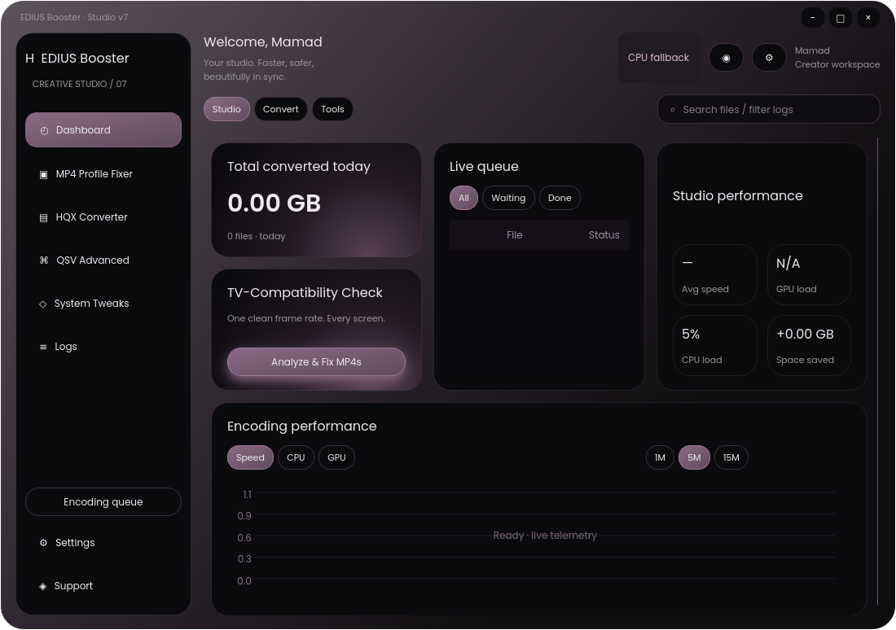

# EDIUS Ultimate Render Booster v7 — Bug-fix Round 1

Windows-first **PySide6 desktop application** for EDIUS/Voukoder MP4 repair, HQX watch-folder conversion, QSV encoding and TV compatibility inspection. Original application / credit: **Mohammad Irani**.



Original Tkinter source, visual reference and implementation prompt are preserved. The old application is never imported or executed. This round addresses false verification failures, slow analysis and unsafe execution defaults.

## Run on Windows

Windows 10/11 x64, Python **3.10–3.13**, FFmpeg **6+** with `libx264`/AAC and matching ffprobe. Intel drivers are necessary only for QSV; CPU fallback works without Intel hardware.

```powershell
py -3.12 -m venv .venv
.\.venv\Scripts\python -m pip install -r requirements.txt
.\.venv\Scripts\python main.py
```

Put `ffmpeg.exe` and `ffprobe.exe` beside `main.py` / the packaged EXE, or on PATH. A missing executable produces a clear message. Use **Settings → Restart as administrator** only for opt-in Windows system tweaks. No system tuning is applied automatically, except restoration of a previous crash-recovery marker.

## Safe defaults (Round 1)

- **One job**, **NORMAL CPU/I/O priority**, **Safe mode ON**, **High priority OFF**.
- Safe mode uses `max(2, logical_cores - 2)` decode/encode threads, two filter threads, QSV async depth 4 and 16 extra upload frames. Where at least three CPUs are available, affinity reserves one or two logical cores for the OS/UI. A two-core PC cannot reserve cores while honoring the two-thread minimum; NORMAL scheduling still allows the UI to run.
- Settings permits **1–3 jobs** with a visible warning. Free RAM below **3 GiB** overrides the setting to one job and logs why.
- RAM >90% **or** CPU >95% sustained for ten seconds automatically pauses dispatch and active FFmpeg process trees. A tray notification / visible queue reason is shown. Free resources, then explicitly **Resume**. The guard is retained in Performance mode as well.
- **Performance mode** enables unrestricted encoder threads / larger upload buffers and stops reserving affinity. It does not automatically enable High priority. Mode changes affect newly dispatched jobs, not a running encode.
- An upgrade migrates old unsafe Auto/two-job or four-job settings back to one safe job once. Explicit choices made after that migration are preserved.
- Encoding window refresh is capped at **two times per second**. Probes, conversions, previews and process pause/resume operations run in background threads. Pipe drainage is concurrent and memory-bounded.

## Convert / inspect files

1. Open **MP4 Profile Fixer**, choose a folder and preset. Files are discovered recursively; generated outputs are excluded.
2. **Analyze files** reads stream metadata, then samples only the first ~20 seconds and three short middle/late/end windows. All ffprobe calls have a **15-second deadline**. No whole-file packet scan remains, including during output verification.
3. The queue shows **Reading streams…** / **Checking frame timing…**. Select a row and **Skip analysis** (also in its context menu) to interrupt probing for that file.
4. A timing timeout/skip marks analysis **Unverified** and conversion continues using known stream metadata. If stream metadata itself times out or is skipped, conservative geometry and a selected fixed rate (or 25 fps if Auto is unknown) are used; the eventual output remains a warning rather than being falsely certified. Originals are preserved.
5. **Auto** selects each file's own standard rational cadence. Universal TV now preserves **1080p59.94/60** with legal Level 4.2 instead of silently halving the source rate. Other preset limits and an explicitly selected FPS cap still apply. Fixed 29.97/59.94 are exact `30000/1001` / `60000/1001`.
6. Start conversion. The Encoding window opens automatically; closing it hides it without stopping the queue. Source deletion is **OFF** by default.

### Audio and timestamps

TV audio is **always re-encoded**, even if an old settings file selected Copy:

```text
-c:a aac -profile:a aac_low -ar 48000 -ac 2 -b:a 192k
-af asetpts=...,aresample=async=1:first_pts=0,apad
```

Offset-aware timestamp normalization and AAC padding keep the original relative audio timing. Missing source audio receives a silent track when the stream probe is known. All output audio tracks are inspected for AAC/LC, ≤2 channels and 48 kHz.

Output commands keep `-fflags +genpts`, `-fps_mode cfr`, the selected rational `-r`, `-avoid_negative_ts make_zero`, and consistent video/movie timescales. **Negative packet DTS is not an error:** B-frame decoding can legitimately precede presentation. Verification instead requires video `start_time >= -0.1 s` and absolute audio/video start difference **<40 ms**, in addition to the duration check. A timing violation receives at most one CPU retry with **`-bf 0`**; the first successful output is preserved while retrying.

Levels are calculated per file from output dimensions and FPS: 1080p30 → 4.1, 1080p59.94/60 → **4.2**, 2160p30 → 5.1. Lower manual levels are raised automatically.

### Green, yellow and red results

- **TV-Safe ✓**: output ffprobe values and sampled policy checks passed.
- **Warning** (yellow): conversion succeeded, but compatibility, timestamp or inspection checks are inconclusive / violated. **The output is committed and kept**, and the original is never deleted. A failed timing-repair retry also keeps the first successful encoded output.
- **Failed: actual reason**: real FFmpeg non-zero exit / launch failure or no nonempty output file, after its single software retry. It is never a bare failure label.
- **Blocked: actual reason**: missing tools, invalid settings or input-analysis errors that prevent a job from starting.

Logs → Details includes exact commands for both attempts, bounded stderr tails and the **output's actual ffprobe fields**: codec, profile, level, pixel format, dimensions, nominal/average FPS, audio codec/profile/channels/rate, start times and durations. Compatibility warnings do not generate red encoder-failure logs. Verification-only simulation also reports yellow rather than rejecting an existing file.

## Other features

- Capability-cached one-second QSV device / encoder / ICQ / decode/VPP tests (no `-low_power`); hardware-resident or CPU-decode/upload pipelines where supported; libx264 fallback.
- AVC 8-bit 4:2:0 / avc1, safe profiles, even dimensions / square pixels, closed two-second GOP, bounded VBV, limited BT.709/SD tags, AAC stereo and MP4 faststart. Metadata, chapters and extra data/subtitle streams are removed.
- Recursive AVI/MOV/MKV watch folder: unchanged path, size and modification time for six seconds before enqueue. HEVC/AV1 are hardware-gated and labeled verified / modern-devices-only, not universally TV-safe.
- Progress / ETA / size prediction, queue ordering, pause/resume, stop/skip, retry, atomic partial-file staging, optional scratch, output collision reservation and folder launchers.
- FAT32 size warning, bitrate-to-fit or verified segments; a split warning retains the master output. Estimated size is not an exact size guarantee.
- Explicit reversible Windows tweaks: cloned AC power plan, core parking, EDIUS priority, thermal guard, timer/visual effects/services, reversible application suspension, BorisFX integration, ImDisk and optional Defender exclusion. Neither priority nor thermal controls implicitly change power/core parking. A write-ahead marker restores originals on exit / next startup with adequate permissions. FFmpeg High priority is controlled separately in Settings.
- Dark frameless Qt dashboard, custom cards/pills/toggles/chart, bounded structured Logs, monitor, persisted settings, EN/فارسی navigation and RTL. Bundled Poppins/Vazirmatn fonts include OFL licenses.

## Limits and validation

See **[Round 1 results](docs/ROUND1.md)** and the machine-readable **[output ffprobe report](docs/ROUND1_RESULTS.json)**. The real `Khanum 1.mp4` / `Agha 1.mp4` were **not supplied**; reported reruns use explicitly named synthetic stand-ins, not those originals.

TV simulation is a policy checker, not a physical TV emulator. Sampled timestamps do not prove every timestamp / visual frame in a long program is correct. GOP/VBV options are set but not independently certified by a complete bitstream analyzer. No HDR→SDR tone mapping is performed. Genuine Intel driver behavior, Windows load/notification behavior and actual TV playback need target-machine checks.

Queue capped at 5000 files, logs 400 records / 100 visible cards, charts 1800 points, bounded stderr tails, bounded probe stdout and at most 8192 retained PTS samples per window. These bounds reduce memory risk but cannot guarantee against OS/driver out-of-memory failures, especially for 4K interpolation. GPU load is honestly N/A when unavailable. UI is a close design interpretation rather than pixel-identical, and some technical descriptions remain English. The selected-job preview is not a separate pane per concurrent encode.

## Tests / packaging

```powershell
.\.venv\Scripts\python -m pip install -r requirements-dev.txt
.\.venv\Scripts\python -m pytest -q
.\.venv\Scripts\python -m PyInstaller --clean --noconfirm EdiusBooster.spec
```

Build the EXE **on Windows**. The one-folder spec includes fonts/icons and local FFmpeg binaries if present. Respect FFmpeg GPL/LGPL redistribution requirements. On Linux/headless use `QT_QPA_PLATFORM=offscreen`; native EGL/GL/xkbcommon/D-Bus libraries and FFmpeg/ffprobe on PATH are needed to run all integration/GUI tests.

Settings / recovery: `%APPDATA%\EdiusBooster\settings.json`, `restore.json`. Recovery cannot run while the PC is powered off; failed restoration remains journaled for a later attempt. Shutdown/sleep are explicit, are suppressed on warning/error results or watch mode, and shutdown has a 60-second cancellation period (`shutdown /a`).

Project layout: `main.py`, `app/core/` (probe, pipeline, TV rules, worker, queue, safety, system tweaks), `app/ui/` (widgets, pages, logs, Encoding), `assets/`, `tests/`, `EdiusBooster.spec`.

### QSV device selection and Haswell / HD 4600

- Hardware self-tests try `-init_hw_device qsv=hw,child_device_type=dxva2`, then
  `qsv=hw,child_device_type=d3d11va`, then `qsv=hw`. The **first successful H.264
  encode** selects the device; it is cached against the FFmpeg binary and probe
  policy version for seven days. Settings shows the selected device and codec /
  ICQ results. Use **Re-probe hardware** after changing Intel drivers.
- Every QSV self-test, Fixer/HQX encode and hardware preview shares that device.
  Old capability caches are automatically invalidated. No QSV command passes
  `-low_power`, including optional-control tests.
- Haswell (including Intel HD 4600) is limited to H.264 QSV encoding with 8-bit
  NV12. HEVC/AV1 GPU encoding is disabled even if stale capabilities say otherwise.
  Tested 8-bit H.264 input uses QSV decode on the same device; CPU-only filters
  download NV12 and re-upload it. Other codecs / 10-bit input use CPU decode,
  explicit `format=nv12,hwupload=extra_hw_frames=16`, then H.264 QSV encode.
  Hardware VPP explicitly requests `format=nv12` as well.
- The Encoding window and Logs show **Using QSV** with device/decode/rate-control,
  or **CPU fallback** with the self-test / runtime / verification failure reason.
  Preview decode failures are separately reported in Logs and the preview tooltip.
- **Quality** replaces the misleading CQP label (saved CQP settings remain
  compatible). It uses `-global_quality` only after an ICQ hardware test succeeds,
  with lookahead disabled and no bitrate options that would override ICQ.
  Otherwise it explicitly uses VBR `-b:v/-maxrate/-bufsize` and reports that
  substitution. Software quality mode uses CRF. ICQ does not impose a VBR bitrate
  ceiling; choose VBR or CBR when a strict TV bitrate budget is needed.
